# WineLib

**Your wine cellar and tasting journal, on maps.** WineLib keeps your bottles, where they sit and what they're
worth, every wine you've tasted and where, and puts them on the map of the world's appellations, down to the
vineyard. It runs on your own computer: your data stays yours.

<picture>
  <source media="(prefers-color-scheme: dark)" srcset="screenshots/demo-dark.gif">
  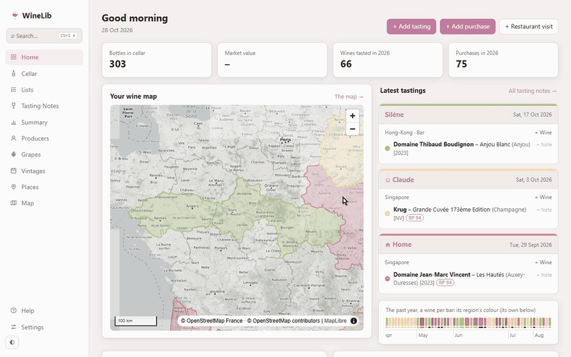
</picture>

## What it does

**Your cellar at a glance.** The map of the regions you drink, your latest tastings, the past year's wines in one
line of colours, what to open tonight (the bottles your lists are waiting for first, then those to drink soon) and
your latest purchases, rack by rack.

<picture>
  <source media="(prefers-color-scheme: dark)" srcset="screenshots/home-dark.png">
  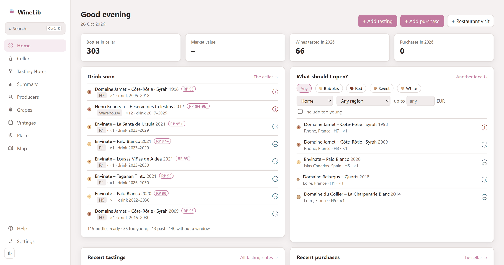
</picture>

**Lists, a treasure hunt.** Wines to find and taste: a critic's top 100, Noble Rot's wines of the decade, the 1855
classification, your wishlist. An entry is a wine, a cuvée (any vintage) or a producer, and ticks itself once you've
tasted it: each list is a mosaic of bottle ends that fill in, in their region's colours, as you go. A wine's or a
producer's page says which lists it's on. Print your bottles from a list as a wine list, or the whole list as a
checklist.

<picture>
  <source media="(prefers-color-scheme: dark)" srcset="screenshots/lists-dark.png">
  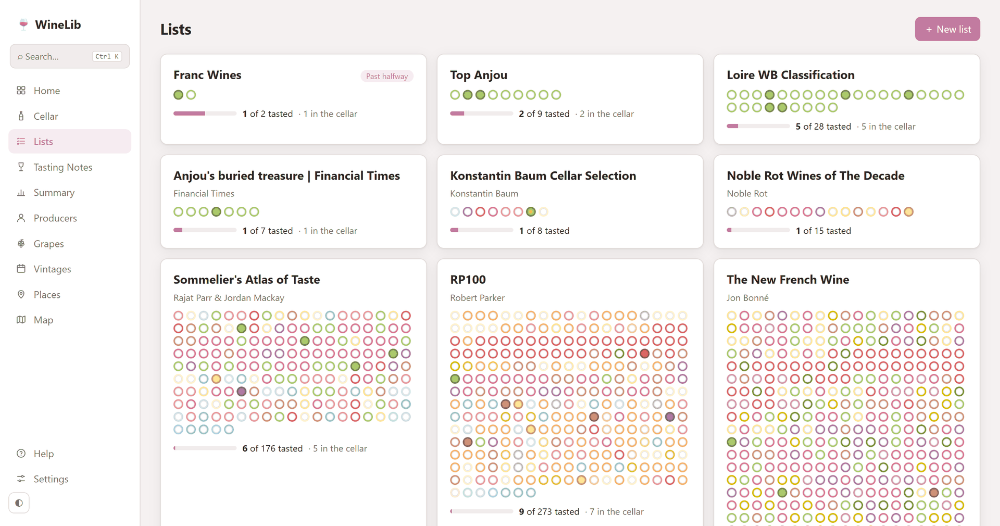
</picture>

<picture>
  <source media="(prefers-color-scheme: dark)" srcset="screenshots/list-dark.png">
  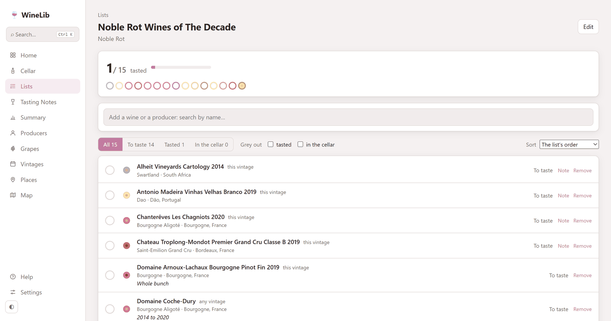
</picture>

**The maps.** Every appellation of France (INAO), the EU, the US and Australia outlined, Burgundy's premiers
crus, and the cadastre's lieux-dits across France's vineyards (Loire, Burgundy, Champagne, Beaujolais, Jura, Alsace, Bordeaux,
Rhône) with the appellations each can claim; regions in their colours, your cellar and your tastings on them. A wine
page shows its appellation and vineyard; a region's page, where what you drink comes from. Click a lieu-dit to make
it a wine's vineyard, or let Maintenance find the cuvées named after one. Any map opens full size, the page's cards
beside it (a sheet you scroll on a phone). A muted map of its own in light and dark, and IGN's aerial
photos in France.

<picture>
  <source media="(prefers-color-scheme: dark)" srcset="screenshots/worldmap-dark.png">
  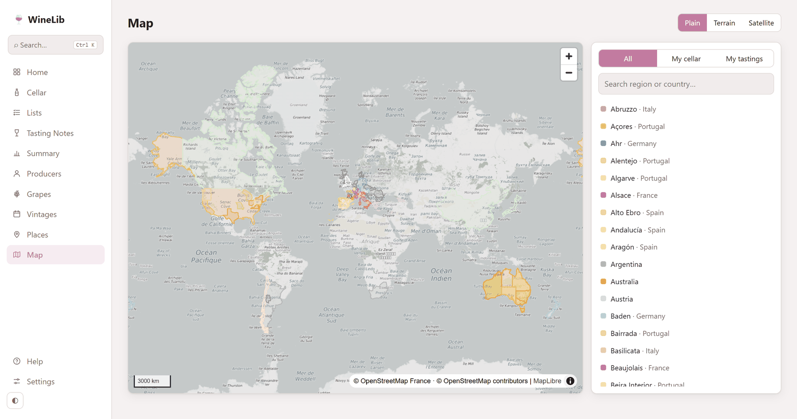
</picture>

<picture>
  <source media="(prefers-color-scheme: dark)" srcset="screenshots/map-dark.png">
  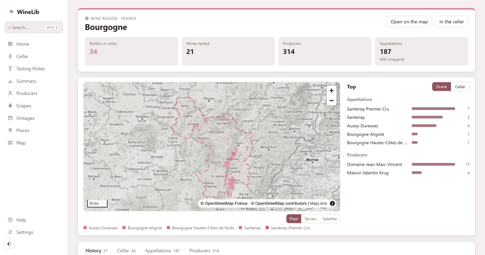
</picture>

<picture>
  <source media="(prefers-color-scheme: dark)" srcset="screenshots/wine-dark.png">
  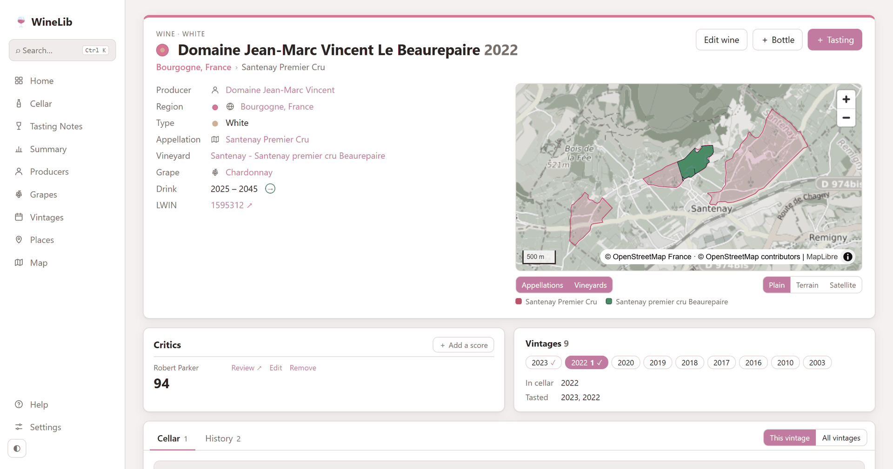
</picture>

**Down to the lieu-dit.** The names on the labels, Les Poyeux, Clos des Noëls, Les Gravières, are lieux-dits:
the named places of France's land register. WineLib draws 91,000 of them across the vineyards of the Loire,
Burgundy, Champagne, Beaujolais, Jura, Alsace, Bordeaux and the Rhône, each with the appellations it can claim and how much of
it is under AOC vines. Zoom in on any map to see them; click one to make it your wine's vineyard. Settings ›
Maintenance finds your cuvées named after one and links them, after your tick.

<picture>
  <source media="(prefers-color-scheme: dark)" srcset="screenshots/lieux-dits-dark.png">
  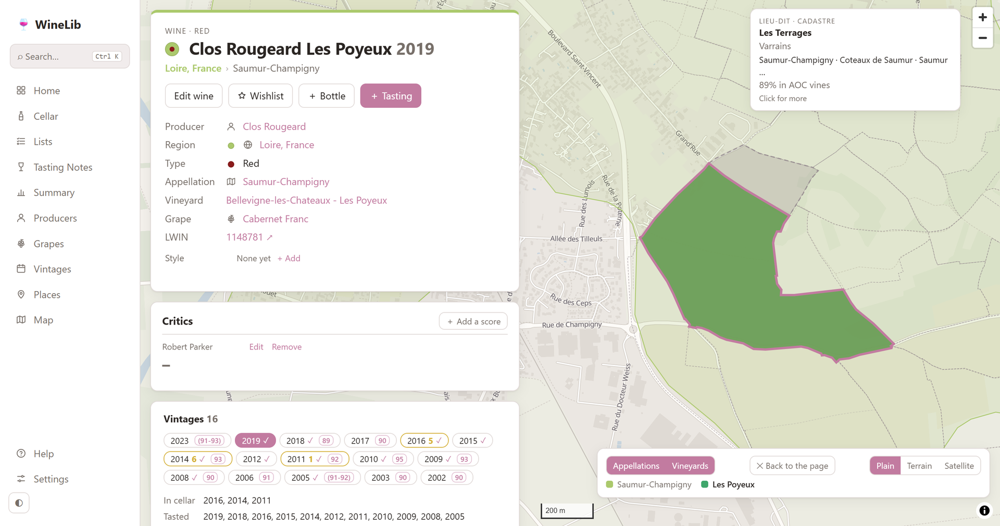
</picture>

**Draw what the map doesn't have.** A monopole, a parcel, an appellation without an official outline: draw it on
the satellite view, start from the official outline and refine it, or import a GeoJSON or KML file.

<picture>
  <source media="(prefers-color-scheme: dark)" srcset="screenshots/draw-dark.png">
  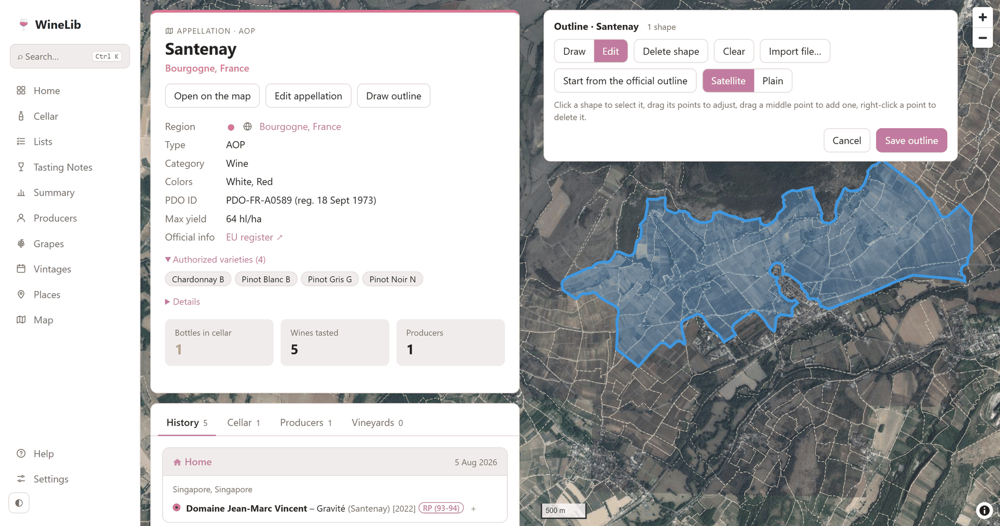
</picture>

**The cellar.** Each storage place as a wine rack: a bottle end per bottle in its region's colour, the wine's colour
as the cork, magnums bigger; hover one for the wine, click to open it. Then the wines, reds and whites apart, with
the critics' scores and whether each is ready to drink. Also a shelf map bin by bin, a list, a vintage
chart, and prices and their changes.

<picture>
  <source media="(prefers-color-scheme: dark)" srcset="screenshots/cellar-dark.png">
  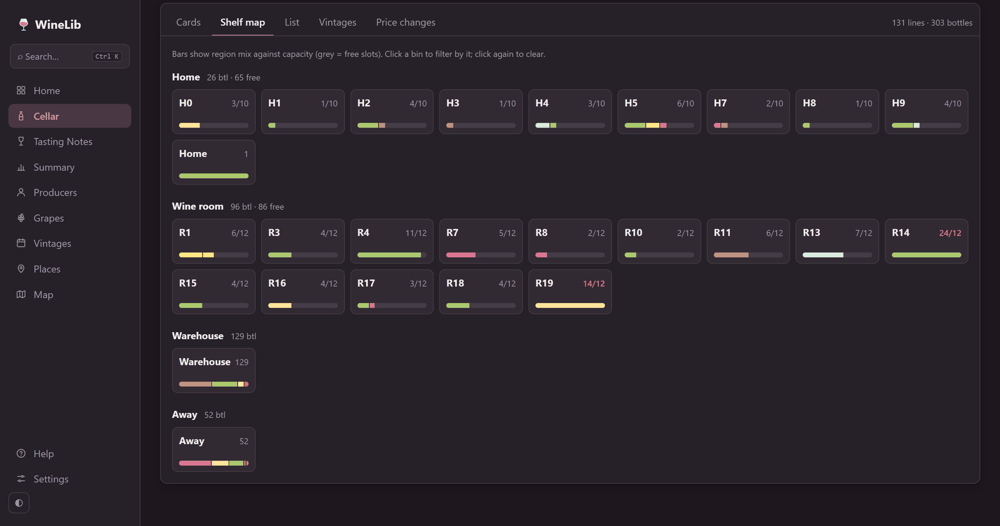
</picture>

**A wine list to print.** Your cellar, a selection of it or your bottles from a list, laid out like a restaurant's
wine list: by colour and region, every vintage you hold on one line. Leave out what isn't for tonight, then print it
or save it as a PDF. From a list, it prints the whole list as a checklist too.

<picture>
  <source media="(prefers-color-scheme: dark)" srcset="screenshots/winelist-dark.png">
  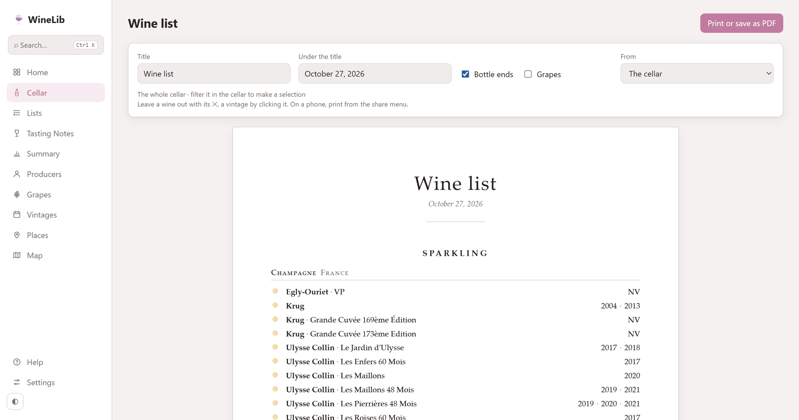
</picture>

**The tasting journal.** Tastings by occasion (a dinner, a restaurant, a trip), with your notes, ratings, photos and
the places on a map; every wine you've tasted in one line of region colours; trends over the years.

<picture>
  <source media="(prefers-color-scheme: dark)" srcset="screenshots/tastings-dark.png">
  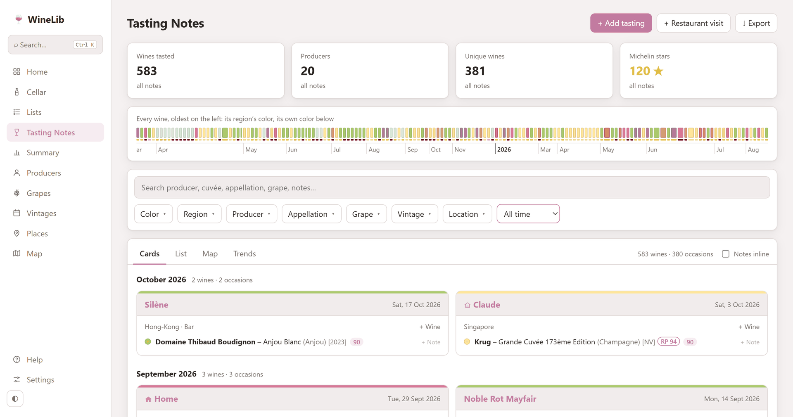
</picture>

**Share a tasting.** Any tasting note, or a whole session's wines, as a sticker for your Instagram story, Strava-style:
a transparent picture with white or dark text, or a card, framed like the journal's. On a phone, Share sends it
straight to the app.

<picture>
  <source media="(prefers-color-scheme: dark)" srcset="screenshots/sticker-dark.png">
  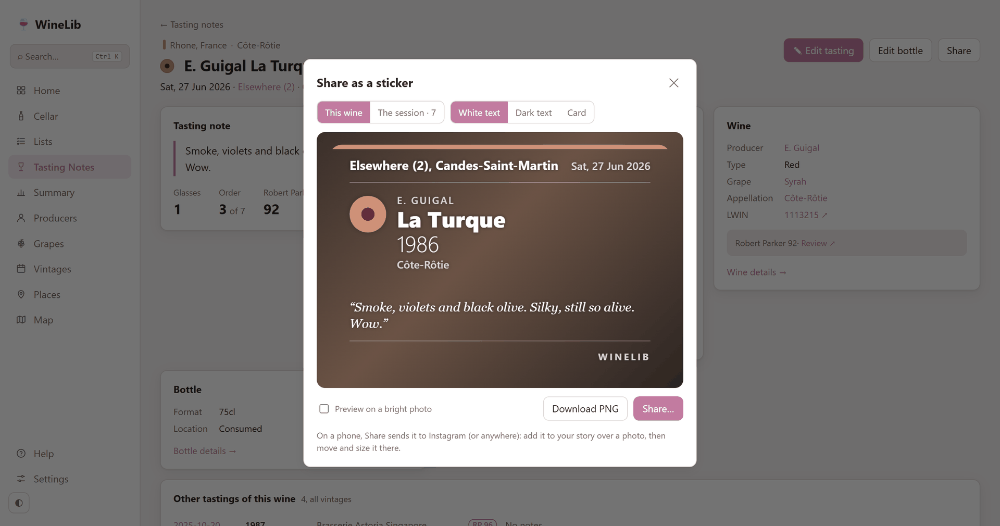
</picture>

**The summary.** Your best-scored wines, the places you go back to, the busiest evening; what you've drunk or hold,
by region, colour, producer, appellation, grape and vintage.

<picture>
  <source media="(prefers-color-scheme: dark)" srcset="screenshots/summary-dark.png">
  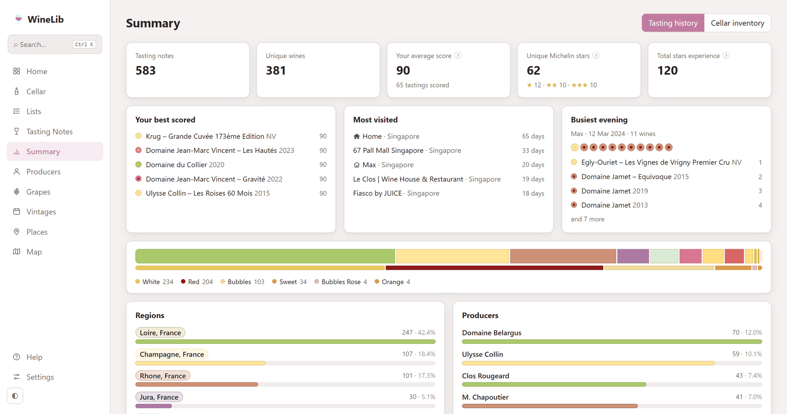
</picture>

**The grapes' family.** 635 grapes with their colour, origin and parents (from VIVC, the Vitis International Variety
Catalogue): a network of every known parent → offspring link, your wines on it, and each grape's family tree.

<picture>
  <source media="(prefers-color-scheme: dark)" srcset="screenshots/grapes-dark.png">
  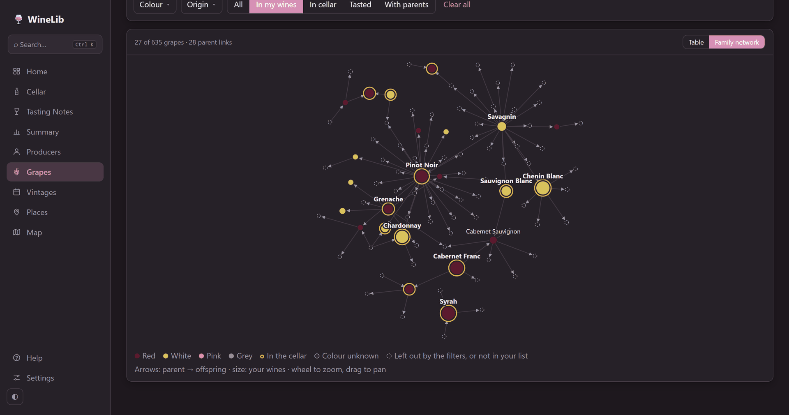
</picture>

<picture>
  <source media="(prefers-color-scheme: dark)" srcset="screenshots/grape-dark.png">
  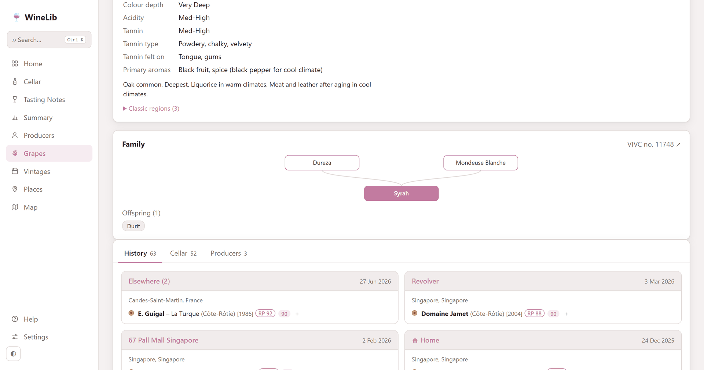
</picture>

**Search everything.** ⌘K (Ctrl K) from any page: wines, producers, appellations, grapes, places, pages.

<picture>
  <source media="(prefers-color-scheme: dark)" srcset="screenshots/search-dark.png">
  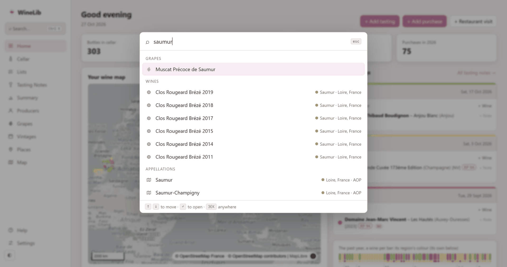
</picture>

**Ask your AI assistant.** An MCP server lets Claude (or any assistant that speaks MCP) read your cellar, journal
and lists: *what should I open from home tonight?*, *which 2019 Burgundies do I have?* It can log for you too, after
your yes: a wine, a tasting or a bottle from a label's photo, or a list from criteria (*a live list of my fresh Loire
whites*): [app/mcp_server](app/mcp_server/README.md).

**Light or dark**, following your system, in nine colour palettes.

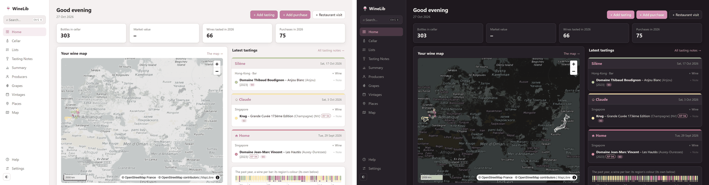

**On your phone** too: the same app in a phone layout, with a menu that folds away, and installable with its own
icon (Add to Home Screen).

<picture>
  <source media="(prefers-color-scheme: dark)" srcset="screenshots/mobile-dark.png">
  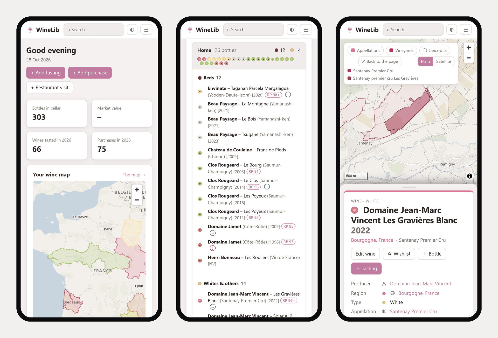
</picture>

And more:

- **A complete reference**: 129 wine regions, 2,900 appellations (every INAO name, AVA, EU PDO and PGI, and eight
  other countries' official registers), 635 grapes with their synonyms, ready on the first start.
- **Style tags** on wines and tastings (fresh, mineral, for ageing… or your own), to filter the cellar and pick
  tonight's bottle; **lists from criteria**, made once or kept live.
- **What happened to a bottle**: drunk, gifted, sold or broken, each undoable.
- **A wine's grapes and blend**: a list of grapes with their share, a blend style (Bordeaux, Rhône, Champagne, field
  blend), filters that find a grape in any blend.
- **Vintages**, **producers** and **places** pages.
- **Critics' scores** from any critic (a CSV of reviews), shown together.
- **Market prices** by LWIN, from Bordeaux Index or WineLabs (with your own keys).
- **Imports** from CellarTracker, Vivino or any spreadsheet; **export** of everything as JSON or CSV.
- **Plug-ins** for your own extras: their pages, Maintenance tasks and actions on the wine page.

## Quick start

**With Docker**: save [`docker-compose.yml`](docker-compose.yml), then

```bash
docker compose up -d
```

and open http://localhost:8000. Your data lives in the `winelib-data` volume.

**With Python** 3.11 or newer: download the zip of the latest release (GitHub › Releases), unzip it, then

```bash
pip install -r app/api/requirements.txt
python run.py
```

It opens http://127.0.0.1:8000. Your data lives in your user folder (`%APPDATA%\winelib`,
`~/Library/Application Support/winelib` or `~/.local/share/winelib`; `--data` for another), apart from the program,
so a newer version finds it.

Either way, the first start opens on a short setup page (your currency, where you keep bottles, your preferred
critic). Then, in Settings › Maintenance:

- **Map outlines** downloads the appellations', vineyards' and lieux-dits' outlines (the map pack);
- **Import a cellar** brings your CellarTracker or Vivino export, or your spreadsheet.

WineLib is reachable from your computer only. To reach it from your phone or another machine, put your own sign-in in
front (Tailscale, a proxy with login): never expose it bare. Postgres works too (`DB_URL`).

From the source: Node.js to build the web app once (`cd app/web && npm install && npm run build`), then
`python run.py`; or `docker compose up -d --build`.

## The data and its sources

The reference data and the map come from official, open sources (INAO, the EU's eAmbrosia register, UC Davis's AVA
project, Wine Australia, Wikidata, VIVC, Natural Earth...), each credited in the app (Settings › About the data) and
in [`app/api/data/docs/sources.md`](app/api/data/docs/sources.md).

## Licence

[MIT](LICENSE). The data keeps its own licences (see above).
